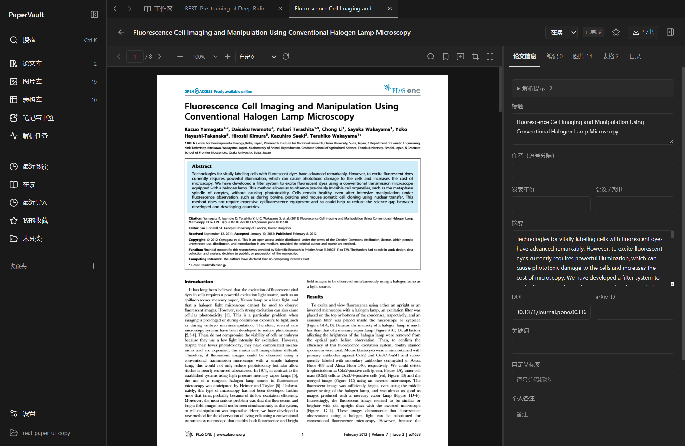

# PaperVault

**把论文、图表和阅读笔记放进同一个本地工作台。**

PaperVault 是面向科研人员的桌面论文库：导入 PDF，在本机提取正文、图片与表格，跨论文搜索，再从结果回到原文。论文和笔记保存在你选择的本地目录，核心功能无需 API Key。

[](https://github.com/Livia-Tassel/PaperVault/actions/workflows/windows.yml)
[](https://github.com/Livia-Tassel/PaperVault/actions/workflows/docs.yml)


[](LICENSE)

[功能](#功能) · [Windows 自行打包](#windows-自行打包) · [开始使用](#开始使用) · [文档](docs/README.md) · [参与改进](CONTRIBUTING.md)

> 当前版本为 **0.2.2**，尚未发布公开安装包，可按下方步骤在 Windows 上自行构建。[Releases](https://github.com/Livia-Tassel/PaperVault/releases) 用于查看后续发布；源码仓库不包含安装器、模型权重或本机演示视频。macOS / Linux 安装包尚未验证。



*0.2.1 Windows 安装版实机截图。截图中的公开论文及许可见[来源记录](docs/verification/0.2.1/real-papers/installed-native/report.json)。*

## 功能

| 场景 | 可以做什么 |
| --- | --- |
| 收集论文 | 批量导入 PDF、拖入文件或递归导入文件夹，按内容哈希去重，用标签和收藏夹整理 |
| 连续阅读 | 多论文标签页、阅读位置恢复、页内查找、书签、缩放与旋转，支持亮暗主题 |
| 找回图表 | 跨论文浏览图片和表格，搜索图注与表格内容，定位到来源 PDF 的页码和区域 |
| 提取与导出 | 本地 CPU 解析；图片导出 150 / 300 / 600 DPI PNG，表格导出 CSV / HTML / PNG，支持人工校对与裁剪 |
| 记录笔记 | 文本高亮、区域笔记、全库笔记搜索与来源定位，导出 Markdown / JSON；重新解析保留笔记 |
| 保存与备份 | 未保存编辑保护、显式处理修改冲突、完整 ZIP 备份与恢复到独立目录 |

模型准备完成后，核心解析、阅读、搜索、编辑和导出可离线使用。搜索采用中英文关键词检索；高级 OCR、语义搜索与云同步列在[后续工作](docs/KNOWN_ISSUES.md)。

## Windows 自行打包

以下命令在 **Windows x64 的 PowerShell** 中执行。需要构建工具的是打包电脑；生成的安装版内置 Python 后端。

### 1. 准备构建环境

| 工具 | 要求 |
| --- | --- |
| Git | 能执行 `git clone` |
| Python | **3.12 x64**，加入 PATH；项目要求 `>=3.12,<3.13` |
| Node.js | **24**，包含 npm，加入 PATH |
| Rust / C++ | Rust MSVC 工具链、Visual Studio C++ Build Tools 和 Windows SDK；下方脚本可补齐 |

```powershell
git clone --depth 1 --single-branch https://github.com/Livia-Tassel/PaperVault.git
cd PaperVault

# 确认当前命令使用 Python 3.12 和 Node.js 24
python --version
node --version

# 创建 .venv，安装锁定的 Python / npm 依赖，并准备 Rust / MSVC 工具
powershell -NoProfile -ExecutionPolicy Bypass -File .\scripts\bootstrap-windows.ps1 -InstallToolchain
```

工具和依赖下载需要网络。若 Build Tools 提示重启，先完成重启，再进入仓库目录继续。已自行配置 Rust / MSVC / SDK 时，可省略 `-InstallToolchain`。

### 2. 构建安装包

```powershell
powershell -NoProfile -ExecutionPolicy Bypass -File .\scripts\package-windows.ps1
```

脚本依次冻结 Python 后端、验证后端启动与退出、构建前端和 Tauri 应用，最后生成 NSIS 安装包并打印 SHA-256。后端验证失败时会停止打包，应先处理日志中的错误。

默认打包配置包含离线 WebView2 安装器；如需在安装时下载 WebView2，可使用：

```powershell
powershell -NoProfile -ExecutionPolicy Bypass -File .\scripts\package-windows.ps1 -OnlineWebViewInstaller
```

### 3. 找到并安装产物

0.2.2 的输出路径为：

```text
apps/desktop/src-tauri/target/x86_64-pc-windows-msvc/release/bundle/nsis/PaperVault_0.2.2_x64-setup.exe
```

双击安装器即可安装。`target/` 是 Git 忽略的构建目录，只有打包成功后才会出现这个文件。解析模型独立于安装包，首次启动后在设置中下载，或导入完整离线模型目录。

当前安装器未签名，构建记录来自含开发工具的 Windows 主机，尚无干净 Windows VM 验证。完整环境说明、校验命令及排错见 [Windows 构建指南](docs/WINDOWS.md)。

### 只想运行源码

完成上面的环境准备后，在仓库根目录执行：

```powershell
powershell -NoProfile -ExecutionPolicy Bypass -File .\scripts\dev-desktop.ps1
```

浏览器调试、测试与 API 类型生成见[开发指南](docs/development/README.md)。

## 开始使用

1. 选择一个本地空文件夹创建论文库，或打开已有 PaperVault 库。
2. 在设置中下载解析模型，或导入包含 `papervault-models.json` 的完整离线模型目录。
3. 导入 PDF，等待解析任务完成，再浏览论文、图片与表格。
4. 搜索关键词、记录笔记，使用“查看原文”核对来源；定期将备份保存到其他磁盘。

常用快捷键：`Ctrl+O` 导入论文，`Ctrl+K` 全局搜索，`Ctrl+F` 查找当前 PDF，`Ctrl+S` 保存编辑。更多操作见[用户指南](docs/USER_GUIDE.md)。

## 仓库结构

```text
PaperVault/
├── apps/desktop/          # React / TypeScript 界面与 Tauri 桌面壳
├── backend/papervault/    # FastAPI、本地数据库、解析任务与模型管理
├── scripts/              # 开发、打包、验收与演示工具
├── tests/                # 单元 / 集成 / 解析测试及样本来源
├── docs/
│   ├── development/      # 开发指南、架构与技术决策
│   ├── verification/     # 各版本测试报告、构建记录与交付哈希
│   └── archive/          # 历史开发进度与原始项目需求
├── CONTRIBUTING.md       # 问题反馈与修改指南
└── CHANGELOG.md          # 版本变更
```

依赖版本由 `requirements.lock`、`package-lock.json` 和 `Cargo.lock` 管理。[脚本索引](scripts/README.md)说明常用命令，完整文档从 [docs/README.md](docs/README.md) 进入。

## 文档

| 想了解什么 | 入口 |
| --- | --- |
| 使用、快捷键与备份 | [用户指南](docs/USER_GUIDE.md) |
| Windows 构建与发布文件 | [Windows 构建指南](docs/WINDOWS.md) · [发布与下载说明](docs/RELEASES.md) |
| 开发与系统设计 | [开发指南](docs/development/README.md) · [架构](docs/development/ARCHITECTURE.md) · [技术决策](docs/development/DECISIONS.md) |
| API 与数据格式 | [本地 API](docs/API.md) · [阅读与笔记 API](docs/READING_API.md) · [数据格式](docs/DATA_FORMAT.md) |
| 验证与适用范围 | [验证索引](docs/verification/README.md) · [已知问题](docs/KNOWN_ISSUES.md) |
| 演示与素材来源 | [演示说明](docs/DEMO.md) |

数字原生 PDF 是当前重点。复杂表格、跨页布局、科学符号和图片裁剪仍可能需要人工校对，导出前应对照原文。现有真实论文测试覆盖 27 篇、314 页，详细结果和未解决问题见[原 7 篇报告](docs/REAL_PAPER_TESTS.md)及[扩展 20 篇报告](docs/EXPANDED_PAPER_TESTS.md)。

## 参与改进

遇到问题或希望增加功能，可提交 [Issue](https://github.com/Livia-Tassel/PaperVault/issues)。环境准备、验证要求与 PR 说明见 [CONTRIBUTING.md](CONTRIBUTING.md)。

## 许可与致谢

本项目源码按 [LICENSE](LICENSE) 保留所有权利。第三方组件、模型和测试论文保留各自许可，详见[第三方声明](docs/THIRD_PARTY_NOTICES.md)。

PaperVault 使用 Tauri、React、FastAPI、Docling、PDFium、PDF.js 与 SQLite 构建。
